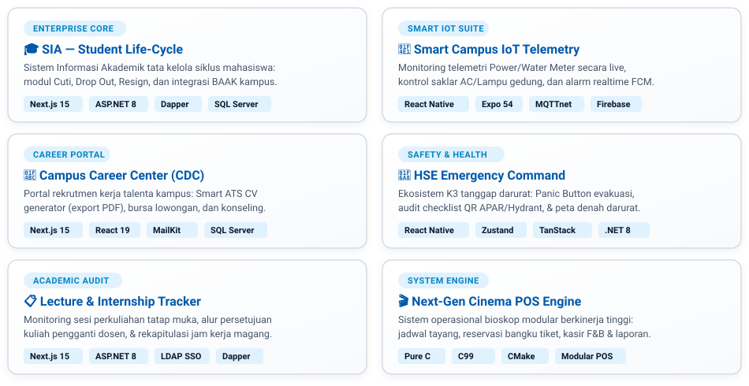

<!-- Custom Animated Banner Header (Banner gif.gif) -->
<div align="center">
  

  <br/><br/>

  <!-- Modern Pill Badge Contacts (Rendered via Clean Vector Component) -->
  <p align="center">
    <a href="https://wa.me/6285943549411" target="_blank">
      
    </a>
    &nbsp;&nbsp;
    <a href="mailto:djohanbaw001@gmail.com">
      
    </a>
    &nbsp;&nbsp;
    <a href="https://www.linkedin.com/in/djohan-manajemen-informatika-018838326/" target="_blank">
      
    </a>
  </p>  <br/>

  <!-- Animated Typing Terminal Subtitle -->
  <a href="https://github.com/alfab3t">
    
  </a>
</div>

---

### 👨‍💻 Tentang Saya

```text
Mahasiswa Manajemen Informatika di Politeknik Astra dengan spesialisasi Rekayasa Perangkat Lunak 
(Software Engineering), Arsitektur Web Enterprise, dan Mobile Native Development. Berpengalaman 
merancang sistem backend berperforma tinggi (ASP.NET Core & Dapper SQL), portal web modern (Next.js 15), 
serta aplikasi telemetri mobile (React Native IoT & HSE Emergency Command).
```

---

### 🚀 Featured Engineering Projects

<div align="center">
  

  <br/><br/>

  <!-- Quick Access Repository Buttons -->
  <p align="center">
    <a href="https://github.com/alfab3t/FE_ASTRA" target="_blank">
      
    </a>
    &nbsp;
    <a href="https://github.com/alfab3t/FE_IOT" target="_blank">
      
    </a>
    &nbsp;
    <a href="https://github.com/alfab3t/FE_CDC" target="_blank">
      
    </a>
    <br/>
    <a href="https://github.com/alfab3t/SHE-NATIVE-DEVELOPMENT-" target="_blank">
      
    </a>
    &nbsp;
    <a href="https://github.com/alfab3t/proyekfe" target="_blank">
      
    </a>
    &nbsp;
    <a href="https://github.com/alfab3t/DESIGN-POPFLIXX" target="_blank">
      
    </a>
  </p>
</div>

<br/>

<!-- Detailed Project Matrix Table (Clean Zaldigengs32 Style) -->
| Proyek Unggulan | Arsitektur & Teknologi | Sorotan Fitur Kunci | Repository |
| :--- | :--- | :--- | :---: |
| **🎓 SIA Student Life-Cycle** | Next.js 15 Turbopack, ASP.NET Core 8, Dapper, SQL Server | Sistem manajemen siklus mahasiswa: modul Cuti Akademik, Drop Out, Pengunduran Diri, dan integrasi BAAK. | [Lihat Kode](https://github.com/alfab3t/FE_ASTRA) |
| **💼 Campus Career Center (CDC)** | Next.js 15, React 19, MailKit SMTP, SQL Server, CKEditor 5 | Portal karir & alumni: Builder CV ATS otomatis (export PDF instan), pelacakan tahapan rekrutmen, dan konseling. | [Lihat Kode](https://github.com/alfab3t/FE_CDC) |
| **📡 Smart Campus IoT Telemetry** | React Native, Expo 54, MQTTnet Broker, Firebase Cloud Messaging | Telemetri sensor real-time: monitoring Power Meter (kWh), debit air, kontrol saklar AC/lampu, dan push alarm. | [Lihat Kode](https://github.com/alfab3t/FE_IOT) |
| **🚨 HSE Emergency Command Suite** | React Native, Zustand, TanStack Query, .NET 8 Web API | Sistem K3 industri: Panic Button tanggap darurat, audit checklist QR APAR/Hydrant, dan peta jalur evakuasi. | [Lihat Kode](https://github.com/alfab3t/SHE-NATIVE-DEVELOPMENT-) |
| **📋 Lecture & Internship Tracker** | Next.js 15, ASP.NET Core 8, Dapper, LDAP Campus SSO | Pemantauan tatap muka perkuliahan dosen, alur persetujuan kuliah pengganti, dan rekapitulasi jam magang industri. | [Lihat Kode](https://github.com/alfab3t/proyekfe) |
| **🎬 Next-Gen Cinema POS** | Pure C (ANSI C / C99), CMake Build Pipeline | POS bioskop performa tinggi: manajemen master data film, penjadwalan tayang studio, reservasi tiket, dan kasir F&B. | [Lihat Kode](https://github.com/alfab3t/DESIGN-POPFLIXX) |

---

### 💻 Tech Stack & Ekosistem

<div align="center">
  
  <br/>
  
</div>

<br/>

<div align="center">

<p>
  <b>Backend & Database</b><br/>
  
  
  
  
  
</p>

<p>
  <b>Frontend & Mobile</b><br/>
  
  
  
  
  
  
</p>

<p>
  <b>Tools & Environment</b><br/>
  
  
  
  
  
  
</p>

</div>

---

### 📊 Statistik GitHub & Aktivitas Coding

<p align="center">
  
  &nbsp;
  
</p>

<p align="center">
  
</p>

---

### 🏆 GitHub Achievements & Milestones

<div align="center">
  <a href="https://github.com/alfab3t?tab=achievements" target="_blank">
    
  </a>
  &nbsp;&nbsp;&nbsp;&nbsp;
  <a href="https://github.com/alfab3t?tab=achievements" target="_blank">
    
  </a>
  &nbsp;&nbsp;&nbsp;&nbsp;
  <a href="https://github.com/alfab3t?tab=achievements" target="_blank">
    
  </a>
  &nbsp;&nbsp;&nbsp;&nbsp;
  <a href="https://github.com/alfab3t?tab=achievements" target="_blank">
    
  </a>
  &nbsp;&nbsp;&nbsp;&nbsp;
  <a href="https://github.com/alfab3t?tab=achievements" target="_blank">
    
  </a>
</div>

<p align="center">
  <sub>Klik badge untuk melihat pencapaian aktivitas di tab <b>Achievements</b> akun GitHub</sub>
</p>

---

<div align="center">
  <sub>© 2026 <b>Djohan Baw</b> • Manajemen Informatika Politeknik Astra • Built with Passion & Precision</sub>
</div>
